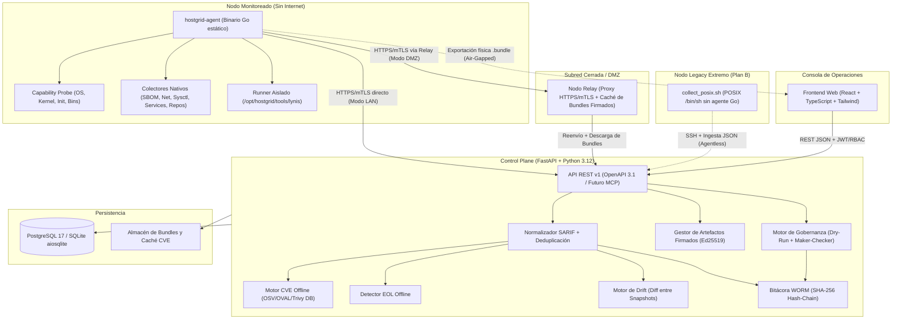
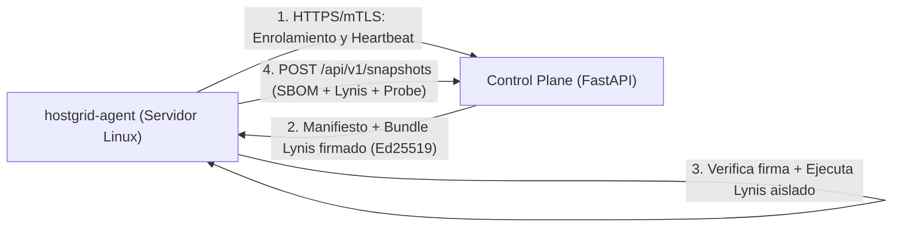
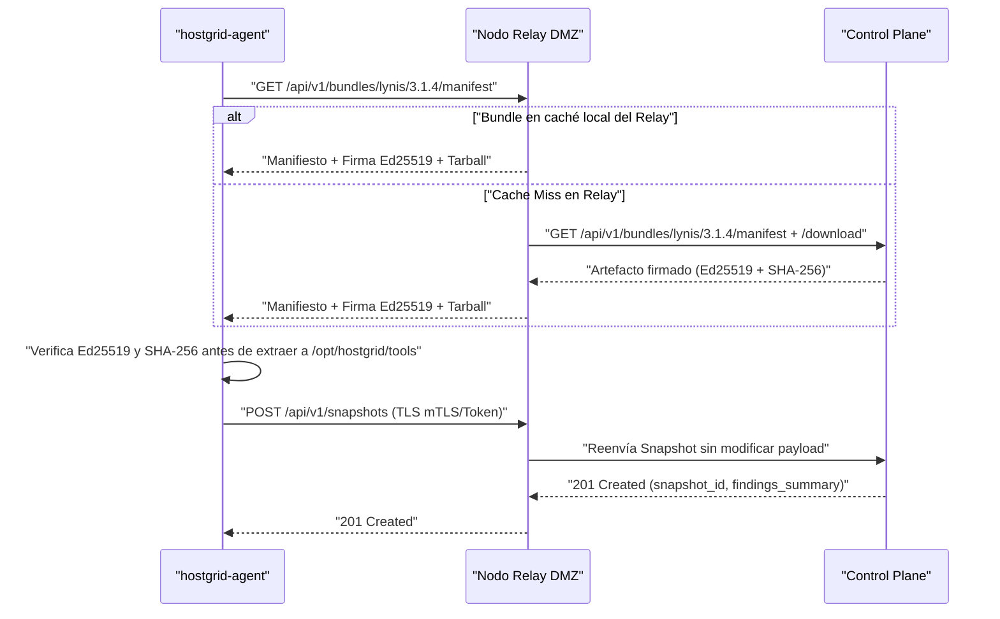
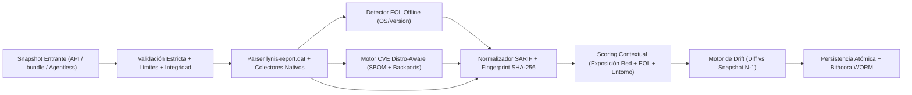
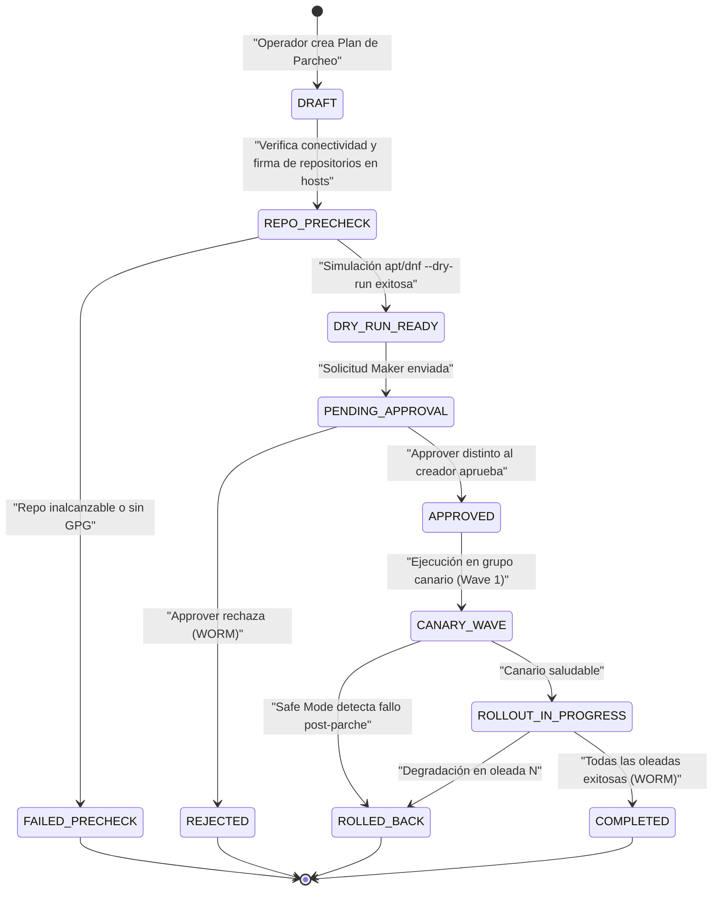

# Arquitectura de HostGrid

> **HostGrid** es un plano de control centralizado de auditoría de postura de seguridad, análisis offline de CVEs consciente de distribución, detección de deriva (*drift*) y parcheo gobernado para flotas de servidores Linux en producción real (entornos sin Internet, redes *air-gapped* y sistemas *legacy*/EOL).

---

## 1. Visión y Principios Arquitectónicos Innegociables

El diseño completo de HostGrid se rige por siete invariantes técnicos que condicionan cada módulo del agente, del plano de control y de la consola web:

| # | Principio | Invariante de Diseño | Implementación en HostGrid |
| :--- | :--- | :--- | :--- |
| **1** | **Offline-First** | Cero acceso a Internet desde nodos monitoreados. | El Servidor Central es el único punto autorizado para actualizar bases de CVEs, tablas EOL y empaquetar herramientas portables firmadas. |
| **2** | **Cero Dependencias en Agente** | Binario único estático sin Python, Node ni `glibc` moderna. | Agente en Go 1.22+ compilado con `CGO_ENABLED=0` para `linux/amd64`, `linux/arm64` y `linux/386` (compatible desde Debian 8 / CentOS 6 / Ubuntu 14.04 hasta Ubuntu 26.04 / Debian 13 / RHEL 9). |
| **3** | **Modelo Pull Seguro** | Cero puertos de escucha en los servidores auditados. | El agente inicia siempre conexiones salientes TLS 1.3 (HTTPS/mTLS) hacia el Control Plane o nodo Relay. |
| **4** | **Herramientas Aisladas** | Prohibido instalar paquetes en el host (`apt`/`yum`). | Toda herramienta externa (ej. Lynis portable) se distribuye desde el servidor, se verifica con Ed25519 + SHA-256 y se ejecuta aislada bajo `/opt/hostgrid/tools/`. |
| **5** | **CVE Distro-Aware** | Sin falsos positivos por *backports* ni escaneo local. | El agente extrae solo el inventario SBOM (`/var/lib/dpkg/status`, base RPM o `apk`); el servidor cruza contra OSV/OVAL/Trivy offline y catálogo EOL. |
| **6** | **Degradación Controlada** | Ningún módulo falla por ausencia de herramientas modernas. | *Capability Probe* inicial detecta kernel, distro, sistema `init` y binarios; registra `not_supported_on_os` cuando no aplica y selecciona el recolector clásico equivalente. |
| **7** | **Gobernanza por Diseño** | Ningún cambio en producción sin verificación previa ni auditoría. | Verificación de repositorios, `Dry-Run` obligatorio, flujo `Maker-Checker`, despliegue canario, `Safe Mode` con *rollback* y bitácora WORM encadenada por SHA-256. |

---

## 2. Vista de Componentes del Sistema

### Responsabilidades por Capa

1. **Agente (`agent/`)**:
   - Ejecuta la detección de capacidades (*Capability Probe*) sin asumir binarios modernos.
   - Recolecta hechos objetivos del sistema de archivos y sockets sin ejecutar código no verificado.
   - Verifica firma Ed25519 y hash SHA-256 de herramientas portables antes de extraer o invocar procesos.
   - Opera en tres modos CLI: `run` (daemon), `scan` (ejecución única hacia API) y `scan --offline-export` (generación de `.bundle` firmado para redes *air-gapped*).
2. **Plan B Agentless (`agentless/`)**:
   - Script POSIX `/bin/sh` puro para *appliances* cerrados o kernels antiguos donde un binario Go moderno no pueda arrancar.
3. **Plano de Control (`server/`)**:
   - Autentica usuarios humanos (JWT + Argon2id + RBAC) y nodos monitoreados (enrolamiento único -> credencial rotativa/mTLS).
   - Normaliza reportes de Lynis y recolectores nativos a un esquema unificado compatible con SARIF 2.1.0.
   - Evalúa estado EOL, cruza paquetes contra feeds CVE conscientes de *backports*, calcula riesgo contextual, computa el *drift* contra el snapshot previo y persiste todo evento crítico en la bitácora WORM.
4. **Consola Web (`web/`)**:
   - Interfaz operativa en modo oscuro de alta densidad informativa: vista de flota, detalle de servidor con comparación de *drift*, búsqueda inversa global de CVEs, importador *air-gapped* de `.bundle` y cola de gobernanza.

---

## 3. Topologías de Conectividad

HostGrid soporta tres modos de conectividad nativa para el agente y un modo complementario *agentless*.

### 3.1. Modo 1: LAN / VPN sin Internet (Pull Directo)

### 3.2. Modo 2: Subred Cerrada vía Nodo Relay (DMZ)

El nodo Relay actúa exclusivamente como proxy de reenvío y caché de artefactos firmados. **El Relay nunca posee la clave privada Ed25519**; si un Relay fuera comprometido, no puede falsificar herramientas ejecutables en los agentes porque cada agente valida la firma contra la clave pública fijada durante su enrolamiento.

### 3.3. Modo 3: Air-Gapped Total (Exportación `.bundle`)

```mermaid
flowchart LR
    A["hostgrid-agent --offline-export /tmp/host.bundle"] -- "1. Empaqueta snapshot + lynis-report.dat + manifest.json + SHA-256" --> B["Archivo .bundle (tar.gz)"]
    B -- "2. Transferencia física controlada (USB/Bastión)" --> C["Operador en Consola Web"]
    C -- "3. Upload POST /api/v1/snapshots/import-bundle" --> D["Control Plane"]
    D -- "4. Valida límites, anti-zip-slip, SHA-256 y firma" --> E["Ingesta normalizada y Drift"]
```

### 3.4. Plan B Agentless (Sistemas Legacy Extremos)

En servidores donde no es viable ejecutar un binario compilado en Go 1.22 (por ejemplo, kernels 2.6 muy antiguos sin soporte de `epoll`/syscalls requeridas o *appliances* de solo lectura), un operador o bastión ejecuta `agentless/collect_posix.sh` vía SSH (`ssh -T host < collect_posix.sh > host.json`) y envía el JSON resultante al endpoint `POST /api/v1/snapshots/import-agentless`.

---

## 4. Pipeline de Ingesta, Normalización, Riesgo Contextual y Drift

1. **Normalización y Deduplicación**: Cada hallazgo de `lynis`, `native_net`, `native_systemd`, `cve_engine` o `eol_engine` produce un `fingerprint` SHA-256 determinista. Si dos fuentes reportan el mismo problema (por ejemplo, un servicio expuesto y un aviso relacionado), se vinculan o deduplican conservando la evidencia completa.
2. **Evaluación EOL**: Si el sistema operativo superó su fecha de fin de soporte (*End of Life*), el detector emite un hallazgo `eol_engine` con severidad mínima `critical` y factor multiplicador de riesgo en la puntuación del host.
3. **Riesgo Contextual**: Un CVE `medium` o `high` en un paquete cuyo demonio está escuchando activamente en `0.0.0.0` o `::` (detectado por `native_net`) eleva su `contextual_score` y su severidad efectiva a `critical`, documentando explícitamente la cadena de evidencia en `contextual_factors`.
4. **Cálculo de Drift**: Comparando el conjunto de `fingerprint` del `Snapshot N` frente al `Snapshot N-1` del mismo host, el servidor clasifica cada hallazgo como `new`, `resolved` o `persisted`, y calcula el delta del índice de endurecimiento (`hardening_index_delta`) y variación de CVEs críticos/altos.

---

## 5. Modelo de Amenazas (STRIDE) y Límites de Confianza

### 5.1. Límites de Confianza

- **TB-1 (Red Host -> Control Plane/Relay)**: Canal potencialmente hostil o segmentado; requiere TLS 1.3 y autenticación explícita del host.
- **TB-2 (Cadena de Suministro de Herramientas)**: El servidor distribuye ejecutables/scripts a toda la flota; un paquete alterado comprometería todos los nodos.
- **TB-3 (Archivo `.bundle` Air-Gapped)**: Ingesta manual de archivos comprimidos generados fuera de línea; expuesto a *zip-slip*, *zip-bomb*, JSON malformado y suplantación de identidad de host.
- **TB-4 (Consola Web y API)**: Superficie expuesta a operadores y auditores; riesgo de escalada de privilegios (BFLA/BOLA) e inyección.
- **TB-5 (Persistencia y Auditoría WORM)**: Registros históricos que sirven como evidencia forense y de cumplimiento.

### 5.2. Matriz STRIDE y Controles Obligatorios

| Categoría | Amenaza Concreta | Límite | Controles Implementados por Diseño |
| :--- | :--- | :--- | :--- |
| **Spoofing** | Agente falso enviando snapshots falsificados o suplantando otro host. | TB-1 / TB-3 | Token de enrolamiento de un solo uso con expiración; credencial rotativa por host / certificado cliente mTLS; asociación estricta `host_id <-> credencial`; verificación de huella en `.bundle`. |
| **Tampering** | Modificación de Lynis portable en tránsito o en caché del Relay (*tool poisoning*). | TB-2 | Firma criptográfica **Ed25519** sobre el manifiesto y hash **SHA-256** del tarball verificados por el agente antes de descomprimir; el Relay nunca posee la clave privada. |
| **Tampering** | Ataque *Zip-Slip* / *Path Traversal* al importar `.bundle` o extraer herramientas. | TB-2 / TB-3 | Rechazo absoluto de rutas absolutas, segmentos `..`, *symlinks*, *hardlinks* y archivos especiales; validación estricta de nombres con expresiones regulares y `os.path.realpath`. |
| **Repudiation** | Borrado o alteración retroactiva de aprobaciones de parcheo o snapshots. | TB-5 | Bitácora **WORM** encadenada por hash (`seq_num` monotónico + `prev_record_hash` + `record_hash` SHA-256), serializada con *advisory lock* en PostgreSQL para evitar carreras de reloj. |
| **Information Disclosure** | Recolección accidental de secretos del host o fuga de credenciales en código/logs. | TB-1 / TB-4 | Colectores de solo lectura sobre metadatos de paquetes/red/config; prohibido leer `/etc/shadow` o claves privadas; cero secretos hardcodeados; errores opacos en producción. |
| **Denial of Service** | *Zip-bomb* o payloads gigantes en importación de `.bundle` / `POST /snapshots`. | TB-3 / TB-4 | Conteo de bytes en *streaming* con límite máximo configurable (25 MB comprimido / 100 MB descomprimido en `.bundle`); paginación acotada (`limit <= 100`); *timeouts* explícitos. |
| **Elevation of Privilege** | Inyección de comandos en el agente o bypass de RBAC en API / futuro MCP. | TB-1 / TB-4 | Prohibición total de `sh -c` e interpolación de strings en Go (`exec.Command` con argumentos fijos); RBAC evaluado dentro de la capa de servicios (`admin`, `approver`, `operator`, `viewer`); contenedores `read_only` con `cap_drop: [ALL]`. |

### 5.3. Reglas de Endurecimiento del Agente y del Control Plane

- **Agente Go**:
  - Nunca invoca un shell (`sh -c`, `bash -c`). Todo comando externo usa `exec.Command` con ruta validada y lista explícita de argumentos.
  - Permisos estrictos: `/etc/hostgrid/agent.json` en `0600` (solo `root`), `/opt/hostgrid/tools/` en `0700` propiedad de `root:root`.
  - Validación de manifiesto y descarga atómica en directorio temporal con limpieza garantizada ante fallo.
- **Control Plane Python**:
  - Todos los esquemas Pydantic de entrada aplican `ConfigDict(extra="forbid")`, normalización Unicode `NFKC` y rechazo de caracteres de control `\x00-\x1F`.
  - Contenedores en `deploy/docker-compose.yml` con `read_only: true`, `no-new-privileges:true`, `cap_drop: [ALL]` y red interna aislada para PostgreSQL.

---

## 6. Arquitectura de Gobernanza para Parcheo (Fase 3)

Toda operación mutante sobre los servidores monitoreados sigue una máquina de estados estricta y auditable antes de ejecutar un solo comando de gestor de paquetes:

Invariantes de gobernanza:
1. **Separación de funciones (`Maker-Checker`)**: El usuario que solicita/crea un `PatchPlan` (`operator` o `admin`) no puede aprobarlo (`approver_id != created_by`).
2. **Pre-verificación de repositorios**: Un agente sin acceso a un repositorio interno firmado (APT/RPM espejo local) jamás entra en cola de ejecución.
3. **Safe Mode y Rollback**: Antes de aplicar cambios críticos, el agente registra estado de servicios activos y versión de paquetes/kernel, verificando conectividad y salud de servicios tras el parcheo.

---

## 7. Preparación para Exposición MCP Futura

El Control Plane separa estrictamente los adaptadores de transporte (rutas HTTP en `server/app/api/v1/`) de los casos de uso (`server/app/services/`):

1. **RBAC en capa de servicios**: La verificación de permisos (`admin`, `approver`, `operator`, `viewer`) se ejecuta en los servicios de dominio pasando el contexto de identidad autenticado, nunca confiando únicamente en dependencias HTTP (`Depends()`). Esto permite exponer herramientas de lectura (consulta de flota, búsqueda inversa de CVEs, reporte de drift) y solicitudes de aprobación vía **Model Context Protocol (MCP)** sin duplicar lógica ni abrir brechas de autorización.
2. **OpenAPI 3.1 determinista**: Todos los endpoints declaran modelos Pydantic v2 estrictos (`request` y `response`), facilitando la generación o mapeo directo a esquemas de herramientas MCP (`readOnlyHint`, `destructiveHint`) en fases posteriores.
3. **Compuerta de aprobación para mutaciones**: Cualquier futura herramienta MCP que proponga remediación creará un `PatchPlan` en estado `PENDING_APPROVAL`, requiriendo firma humana en la cola `GovernanceQueue`.
