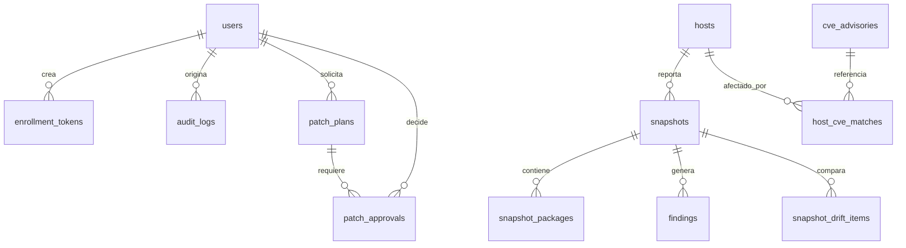

# Especificación Técnica de HostGrid (`SPEC.md`)

Este documento define los contratos normativos de datos, protocolos de comunicación, esquemas de base de datos, formatos de intercambio *air-gapped* y API REST v1 para implementar las Fases 1, 2 y 3 de **HostGrid**.

---

## 1. Convenciones Globales y Matriz RBAC

### 1.1. Convenciones Técnicas

- **Prefijo base de API**: `/api/v1`.
- **Formato temporal**: UTC estricto en RFC 3339 con precisión de milisegundos (`2026-11-19T23:30:00.000Z`).
- **Identificadores**: UUID v4 en formato canónico minúsculas.
- **Paginación**: Parámetros `limit` (entero `1..100`, por defecto `50`) y `offset` (entero `>= 0`, por defecto `0`). Respuesta envolvente `{ "items": [...], "total": int, "limit": int, "offset": int }`.
- **Errores HTTP**: Formato RFC 9457 (`application/problem+json`) con campos `type`, `title`, `status`, `detail`, `instance`, `trace_id`. En `HOSTGRID_ENV=production`, jamás se exponen trazas internas ni detalles de SQL.
- **Validación de entrada**: Todos los DTO Pydantic v2 declaran `model_config = ConfigDict(extra="forbid")`, normalizan cadenas UTF-8 con `NFKC` y rechazan caracteres de control ASCII `\x00-\x1F` (salvo saltos de línea legítimos dentro de bloques multilínea como `lynis-report.dat` cuando correspondan).
- **Idempotencia**: Los endpoints mutantes críticos aceptan cabecera `Idempotency-Key` (UUID v4) para evitar duplicación en reintentos de red o agentes.

### 1.2. Roles y Matriz de Permisos (RBAC)

| Capacidad / Recurso | `viewer` | `operator` | `approver` | `admin` |
| :--- | :---: | :---: | :---: | :---: |
| Consultar flota, hosts, snapshots, hallazgos, drift y CVEs | Sí | Sí | Sí | Sí |
| Exportar reportes (JSON / SARIF / Markdown / HTML) | Sí | Sí | Sí | Sí |
| Importar `.bundle` air-gapped o reporte *agentless* | No | Sí | No | Sí |
| Generar tokens de enrolamiento y registrar bundles de herramientas | No | Sí | No | Sí |
| Crear `PatchPlan` y ejecutar `Dry-Run` (Fase 3) | No | Sí | No | Sí |
| Aprobar / rechazar `PatchPlan` (`Maker-Checker`: `approver != creator`) | No | No | Sí | Sí |
| Verificar cadena de auditoría WORM (`/audit/verify`) | Sí | Sí | Sí | Sí |
| Gestionar usuarios, roles y políticas globales | No | No | No | Sí |

---

## 2. Esquema de Base de Datos

El Control Plane utiliza SQLAlchemy 2.0 asíncrono + Alembic con soporte dual:
- **Producción**: PostgreSQL 17 (`asyncpg`).
- **Desarrollo y pruebas unitarias**: SQLite (`aiosqlite`) evitando tipos propietarios incompatibles cuando exista alternativa portable (UUID como `Uuid(as_uuid=True)`, JSON estructurado vía tipo `JSON` / `JSONB` con dialecto adaptado).

### 2.1. Diagrama Entidad-Relación



### 2.2. Especificación de Tablas

1. **`users`**:
   - `id` (UUID PK), `username` (VARCHAR 64 UNIQUE), `email` (VARCHAR 255 UNIQUE), `password_hash` (TEXT, Argon2id), `role` (`admin|approver|operator|viewer`), `is_active` (BOOLEAN), `failed_attempts` (INT), `locked_until` (TIMESTAMP NULL), `created_at`, `updated_at`.
2. **`enrollment_tokens`**:
   - `id` (UUID PK), `token_hash` (CHAR 64 UNIQUE, SHA-256 del token), `label` (VARCHAR 128), `environment` (`prod|staging|dev|dmz`), `created_by` (UUID FK -> `users.id`), `expires_at` (TIMESTAMP), `used_at` (TIMESTAMP NULL), `used_by_host_id` (UUID NULL), `created_at`.
3. **`hosts`**:
   - `id` (UUID PK), `hostname` (VARCHAR 255), `machine_id_hash` (CHAR 64 UNIQUE), `os_family` (VARCHAR 32: `debian|ubuntu|rhel|centos|alpine|suse|other`), `os_name` (VARCHAR 128), `os_version` (VARCHAR 64), `kernel_version` (VARCHAR 128), `arch` (VARCHAR 16: `amd64|arm64|386`), `init_system` (VARCHAR 32: `systemd|sysvinit|upstart|openrc|unknown`), `connectivity_mode` (`lan|relay|airgapped|agentless`), `environment` (`prod|staging|dev|dmz`), `eol_status` (`supported|approaching_eol|eol|unknown`), `eol_date` (DATE NULL), `repo_access_ok` (BOOLEAN NULL), `last_hardening_index` (INT NULL), `credential_hash` (CHAR 64 NULL), `capabilities_json` (JSON), `last_seen_at` (TIMESTAMP NULL), `created_at`, `updated_at`.
4. **`snapshots`**:
   - `id` (UUID PK), `host_id` (UUID FK -> `hosts.id`, INDEX), `previous_snapshot_id` (UUID NULL FK -> `snapshots.id`), `ingestion_source` (`agent_push|relay_push|offline_bundle|agentless_ssh`), `agent_version` (VARCHAR 32), `collected_at` (TIMESTAMP), `ingested_at` (TIMESTAMP), `hardening_index` (INT NULL), `lynis_version` (VARCHAR 32 NULL), `tests_executed` (INT), `tests_skipped` (INT), `warnings_count` (INT), `suggestions_count` (INT), `critical_cves_count` (INT), `high_cves_count` (INT), `raw_probe_json` (JSON), `raw_network_json` (JSON), `raw_services_json` (JSON), `raw_sysctl_json` (JSON), `raw_repos_json` (JSON), `bundle_sha256` (CHAR 64 NULL).
5. **`snapshot_packages`**:
   - `id` (UUID PK), `snapshot_id` (UUID FK -> `snapshots.id`, INDEX), `package_manager` (`dpkg|rpm|apk`), `name` (VARCHAR 255, INDEX), `source_package` (VARCHAR 255 NULL, INDEX), `epoch` (VARCHAR 16 NULL), `version` (VARCHAR 128), `release` (VARCHAR 128 NULL), `arch` (VARCHAR 32).
6. **`findings`**:
   - `id` (UUID PK), `snapshot_id` (UUID FK -> `snapshots.id`, INDEX), `host_id` (UUID FK -> `hosts.id`, INDEX), `fingerprint` (CHAR 64, INDEX), `source_tool` (`lynis|native_net|native_systemd|cve_engine|eol_engine`), `category` (`hardening|cve|network|service_isolation|eol|integrity`), `severity` (`critical|high|medium|low|info`), `base_severity` (`critical|high|medium|low|info`), `confidence` (`high|medium|low`), `title` (VARCHAR 255), `description` (TEXT), `evidence_json` (JSON), `remediation` (TEXT), `reference_ids_json` (JSON), `contextual_score` (NUMERIC 5,2), `contextual_factors_json` (JSON), `created_at`.
   - Restricción `UNIQUE (snapshot_id, fingerprint)` para garantizar deduplicación por snapshot.
7. **`snapshot_drift_items`**:
   - `id` (UUID PK), `snapshot_id` (UUID FK -> `snapshots.id`, INDEX), `previous_snapshot_id` (UUID NULL FK -> `snapshots.id`), `fingerprint` (CHAR 64, INDEX), `status` (`new|resolved|persisted`), `severity` (`critical|high|medium|low|info`), `previous_severity` (`critical|high|medium|low|info` NULL), `title` (VARCHAR 255), `category` (VARCHAR 32), `created_at`.
8. **`cve_advisories`**:
   - `id` (UUID PK), `cve_id` (VARCHAR 32, INDEX), `ecosystem` (VARCHAR 64: `Debian:11|Ubuntu:22.04|RedHat:9|Alpine:3.19|...`), `package_name` (VARCHAR 255, INDEX), `fixed_version` (VARCHAR 128 NULL), `advisory_status` (`affected|fixed|not_affected|wontfix`), `base_severity` (`critical|high|medium|low`), `cvss_score` (NUMERIC 4,1 NULL), `source_feed` (`osv|oval|trivy`), `summary` (TEXT), `references_json` (JSON), `updated_at`.
   - Índice compuesto `(ecosystem, package_name, cve_id)`.
9. **`host_cve_matches`**:
   - `id` (UUID PK), `host_id` (UUID FK -> `hosts.id`, INDEX), `snapshot_id` (UUID FK -> `snapshots.id`, INDEX), `cve_id` (VARCHAR 32, INDEX), `package_name` (VARCHAR 255, INDEX), `installed_version` (VARCHAR 128), `fixed_version` (VARCHAR 128 NULL), `effective_severity` (`critical|high|medium|low`), `exposed_network` (BOOLEAN), `exposed_ports_json` (JSON), `contextual_score` (NUMERIC 5,2), `detected_at`.
10. **`eol_catalog`**:
    - `id` (UUID PK), `os_family` (VARCHAR 32), `os_version` (VARCHAR 64), `codename` (VARCHAR 64 NULL), `release_date` (DATE NULL), `standard_eol_date` (DATE), `extended_eol_date` (DATE NULL), `notes` (TEXT NULL).
    - Restricción `UNIQUE (os_family, os_version)`.
11. **`tool_bundles`**:
    - `id` (UUID PK), `tool_name` (VARCHAR 64), `version` (VARCHAR 32), `arch` (VARCHAR 32: `noarch|amd64|arm64|386`), `filename` (VARCHAR 255), `sha256` (CHAR 64), `signature_b64` (TEXT), `size_bytes` (BIGINT), `is_active` (BOOLEAN), `published_at`.
    - Restricción `UNIQUE (tool_name, version, arch)`.
12. **`audit_logs` (WORM Inmutable)**:
    - `seq_num` (BIGINT PK / secuencia monotónica), `id` (UUID UNIQUE), `occurred_at` (TIMESTAMP), `actor_id` (UUID NULL), `actor_username` (VARCHAR 64), `action` (VARCHAR 128), `resource_type` (VARCHAR 64), `resource_id` (VARCHAR 128), `details_json` (JSON), `prev_record_hash` (CHAR 64), `record_hash` (CHAR 64 UNIQUE).
    - **Regla de serialización**: En PostgreSQL se adquiere `SELECT pg_advisory_xact_lock(hashtext('hostgrid_worm_audit'))` antes de leer el último `seq_num` y `record_hash`, calculando `record_hash = SHA256(canonical_json(seq_num, prev_record_hash, occurred_at_iso, actor_username, action, resource_type, resource_id, details_json))`. Para el primer registro (`seq_num = 1`), `prev_record_hash = "0" * 64`.
13. **`patch_plans` (Fase 3)**:
    - `id` (UUID PK), `title` (VARCHAR 255), `target_host_ids_json` (JSON), `packages_json` (JSON), `canary_percent` (INT), `status` (`DRAFT|REPO_PRECHECK|DRY_RUN_READY|PENDING_APPROVAL|APPROVED|REJECTED|CANARY_WAVE|ROLLOUT_IN_PROGRESS|COMPLETED|ROLLED_BACK`), `dry_run_report_json` (JSON NULL), `created_by` (UUID FK -> `users.id`), `created_at`, `updated_at`.
14. **`patch_approvals` (Fase 3)**:
    - `id` (UUID PK), `patch_plan_id` (UUID FK -> `patch_plans.id`), `approver_id` (UUID FK -> `users.id`), `decision` (`approved|rejected`), `rationale` (TEXT), `decided_at`.
    - Regla de negocio obligatoria: `approver_id != patch_plans.created_by`.

---

## 3. Esquema Unificado de Hallazgos (Compatible con SARIF 2.1.0)

### 3.1. Modelo JSON Normalizado

```json
{
  "fingerprint": "a3f9b2c1d4e5f60718293a4b5c6d7e8f90112233445566778899aabbccddeeff",
  "source_tool": "cve_engine",
  "category": "cve",
  "severity": "critical",
  "base_severity": "high",
  "confidence": "high",
  "title": "CVE-2024-6387 en openssh-server expuesto en 0.0.0.0:22",
  "description": "La versión instalada 1:8.9p1-3ubuntu0.6 es vulnerable según feed Ubuntu OVAL.",
  "evidence": {
    "package": "openssh-server",
    "source_package": "openssh",
    "installed_version": "1:8.9p1-3ubuntu0.6",
    "fixed_version": "1:8.9p1-3ubuntu0.10",
    "listening_sockets": ["0.0.0.0:22", "[::]:22"],
    "systemd_unit": "ssh.service"
  },
  "remediation": "Actualizar openssh-server a >= 1:8.9p1-3ubuntu0.10 mediante plan de parcheo gobernado.",
  "reference_ids": ["CVE-2024-6387", "USN-6859-1", "CWE-362"],
  "contextual_score": 94.0,
  "contextual_factors": [
    "base_cvss:8.1",
    "exposed_wildcard_socket:0.0.0.0:22(+15)",
    "environment:prod(+10)"
  ]
}
```

### 3.2. Cálculo Determinista de `fingerprint`

```text
canonical_input = lowercase(source_tool) + "|" + lowercase(category) + "|" + canonical_rule_id + "|" + canonical_target_key
fingerprint = hex_sha256(utf8(canonical_input))
```

Ejemplos de clave canónica (`canonical_rule_id` | `canonical_target_key`):
- Lynis: `lynis|hardening|SSH-7408|/etc/ssh/sshd_config`
- CVE: `cve_engine|cve|CVE-2024-6387|openssh-server`
- Red: `native_net|network|UNENCRYPTED_BIND|0.0.0.0:23`
- EOL: `eol_engine|eol|OS_EOL|debian:9`

### 3.3. Reglas de Riesgo Contextual (`contextual_score`)

Puntaje base por severidad original (`critical=85`, `high=68`, `medium=45`, `low=22`, `info=5`), acotado en `[0.0, 100.0]`:
- `+15`: Paquete o servicio asociado a socket escuchando en `0.0.0.0` o `::`.
- `+12`: Host en estado `eol` (sin parches de seguridad del fabricante).
- `+10`: Entorno etiquetado como `prod` o `dmz`.
- `-10`: Servicio enlazado exclusivamente a `127.0.0.1` o `::1` (solo loopback).

Elevación de severidad efectiva:
- Si `contextual_score >= 85.0` -> `severity = "critical"`.
- Si `70.0 <= contextual_score < 85.0` -> `severity = "high"`.
- En otro caso mantiene `base_severity`.

### 3.4. Mapeo a SARIF 2.1.0 (`GET /api/v1/reports/hosts/{host_id}?format=sarif`)

- `runs[0].tool.driver.name` = `"HostGrid"`
- `runs[0].tool.driver.rules[].id` = `<source_tool>:<canonical_rule_id>`
- `runs[0].results[].ruleId` = `<source_tool>:<canonical_rule_id>`
- `runs[0].results[].level`: `critical|high -> "error"`, `medium -> "warning"`, `low|info -> "note"`
- `runs[0].results[].partialFingerprints.primaryLocationLineHash` = `fingerprint`
- `runs[0].results[].properties` = `{ "category", "contextual_score", "contextual_factors", "reference_ids", "evidence" }`

---

## 4. Protocolo Agente <-> Servidor v1

### 4.1. Requisitos de Transporte y Autenticación

- Protocolo obligatorio: HTTPS sobre TLS 1.3 (`crypto/tls` stdlib, `MinVersion: tls.VersionTLS13`, verificación estricta de cadena CA o certificado pinneado en configuración; opción de certificado cliente mTLS).
- Cabeceras estándar en cada solicitud del agente:
  - `User-Agent: hostgrid-agent/<version>`
  - `X-HostGrid-Protocol-Version: 1`
  - `Authorization: Bearer <agent_credential>` (salvo en enrolamiento inicial).

### 4.2. Enrolamiento (`POST /api/v1/enrollments/register`)

**Request**:
```json
{
  "enrollment_token": "hg_enroll_xxxxxxxxxxxxxxxxxxxxxxxxxxxxxxxx",
  "hostname": "srv-app-01.internal",
  "machine_id_hash": "9f86d081884c7d659a2feaa0c55ad015a3bf4f1b2b0b822cd15d6c15b0f00a08",
  "os_family": "debian",
  "os_name": "Debian GNU/Linux",
  "os_version": "12",
  "kernel_version": "6.1.0-26-amd64",
  "arch": "amd64",
  "init_system": "systemd",
  "connectivity_mode": "lan",
  "environment": "prod"
}
```

**Response (`201 Created`)**:
```json
{
  "host_id": "550e8400-e29b-41d4-a716-446655440000",
  "agent_credential": "hg_agent_secret_64hexchars...",
  "bundle_signing_pubkey_b64": "BASE64_ED25519_32_BYTES_PUBKEY",
  "heartbeat_interval_sec": 300,
  "scan_interval_sec": 3600
}
```
El agente persiste esta identidad en `/etc/hostgrid/agent.json` con permisos `0600`.

### 4.3. Heartbeat (`POST /api/v1/agents/{host_id}/heartbeat`)

```json
{
  "agent_version": "0.1.0",
  "lynis_version": "3.1.4",
  "uptime_sec": 482910,
  "last_scan_at": "2026-11-19T22:00:00.000Z",
  "repo_access_ok": true
}
```

### 4.4. Descarga y Verificación de Bundles de Herramientas

1. El agente consulta `GET /api/v1/bundles/lynis/latest/manifest` (o versión fija `/{version}/manifest`).
   ```json
   {
     "tool_name": "lynis",
     "version": "3.1.4",
     "arch": "noarch",
     "filename": "lynis-3.1.4-portable.tar.gz",
     "sha256": "e3b0c44298fc1c149afbf4c8996fb92427ae41e4649b934ca495991b7852b855",
     "size_bytes": 412890,
     "manifest_canonical_json": "{\"arch\":\"noarch\",\"filename\":\"lynis-3.1.4-portable.tar.gz\",\"sha256\":\"...\",\"size_bytes\":412890,\"tool_name\":\"lynis\",\"version\":\"3.1.4\"}",
     "signature_b64": "BASE64_ED25519_64_BYTES_SIG",
     "download_url": "/api/v1/bundles/lynis/3.1.4/download"
   }
   ```
2. **Secuencia obligatoria antes de ejecutar**:
   - Verificar `ed25519.Verify(pubkey, []byte(manifest_canonical_json), sig)` usando la clave pública fijada en `/etc/hostgrid/agent.json`. Si falla, abortar y registrar error de integridad.
   - Si la versión local en `/opt/hostgrid/tools/lynis/<version>/` ya existe y coincide en integridad, omitir descarga.
   - Descargar tarball a archivo temporal en `/opt/hostgrid/tmp/` con límite de tamaño estricto.
   - Calcular SHA-256 en streaming y validar igualdad exacta contra `manifest.sha256`.
   - Desempaquetar rechazando rutas absolutas, `..`, *symlinks* fuera del directorio destino o archivos especiales.
   - Mover de forma atómica (`os.Rename`) a `/opt/hostgrid/tools/lynis/<version>/` con permisos `0700`.

### 4.5. Envío de Snapshot (`POST /api/v1/snapshots`)

```json
{
  "host_id": "550e8400-e29b-41d4-a716-446655440000",
  "collected_at": "2026-11-19T23:10:00.000Z",
  "agent_version": "0.1.0",
  "connectivity_mode": "lan",
  "probe": {
    "os_family": "debian",
    "os_name": "Debian GNU/Linux",
    "os_version": "8",
    "kernel_version": "3.16.0-11-amd64",
    "arch": "amd64",
    "init_system": "sysvinit",
    "capabilities": {
      "network_inspector": { "status": "supported", "binary": "netstat", "fallback_used": true },
      "firewall_inspector": { "status": "supported", "binary": "iptables", "fallback_used": true },
      "systemd_security": { "status": "not_supported_on_os", "reason": "init_system_is_sysvinit", "fallback_used": false },
      "mac_framework": { "status": "not_supported_on_os", "reason": "no_selinux_or_apparmor_detected", "fallback_used": false },
      "package_manager": { "status": "supported", "binary": "/var/lib/dpkg/status", "fallback_used": false }
    }
  },
  "packages": [
    {
      "package_manager": "dpkg",
      "name": "libssl1.0.0",
      "source_package": "openssl",
      "epoch": "",
      "version": "1.0.1t-1+deb8u12",
      "release": "",
      "arch": "amd64"
    }
  ],
  "network": {
    "listening_sockets": [
      { "proto": "tcp", "local_addr": "0.0.0.0", "port": 22, "process": "sshd", "pid": 412 }
    ]
  },
  "services": [
    { "name": "ssh", "state": "running", "init_system": "sysvinit" }
  ],
  "sysctl": {
    "net.ipv4.ip_forward": "0",
    "kernel.kptr_restrict": "0"
  },
  "repos": {
    "access_ok": false,
    "configured_sources": ["deb http://archive.debian.org/debian jessie main"],
    "check_detail": "eol_archive_unreachable_offline"
  },
  "lynis": {
    "executed": true,
    "lynis_version": "3.1.4",
    "report_dat": "lynis_version=3.1.4\nhardening_index=58\n..."
  }
}
```

---

## 5. Formato Exacto del Archivo `.bundle` (Air-Gapped) y Tool Bundle

### 5.1. Contenedor `.bundle` (`hostgrid-agent scan --offline-export`)

- **Formato**: Archivo `tar.gz` con extensión `.bundle` (nombre sugerido: `hostgrid-<hostname>-<YYYYMMDDTHHMMSSZ>.bundle`).
- **Límites de seguridad**: Máximo `25 MB` comprimido, máximo `100 MB` descomprimido, máximo `16` entradas en el archivo tar, solo archivos regulares (permisos `0600`/`0644`), prohibidos directorios transversales (`..`), rutas absolutas, *symlinks* y *hardlinks*.
- **Contenido interno obligatorio**:
  1. `manifest.json`
  2. `manifest.sig` (firma Ed25519 Base64 o HMAC-SHA256 del host cuando exista credencial enrolada; en nodos no enrolados aún, `signature_mode = "sha256_integrity_only"` indicando verificación de operador).
  3. `snapshot.json` (idéntico al esquema de `POST /api/v1/snapshots`, excluyendo o embebiendo `lynis.report_dat` referenciado).
  4. `lynis-report.dat` (opcional si Lynis se ejecutó; su SHA-256 debe coincidir con `manifest.json`).

**Esquema de `manifest.json` dentro de `.bundle`**:
```json
{
  "bundle_format_version": "1.0",
  "bundle_id": "7f3c9b12-4a2e-4f10-9c8a-1234567890ab",
  "created_at": "2026-11-19T23:12:00.000Z",
  "hostname": "srv-airgap-01",
  "machine_id_hash": "9f86d081884c7d659a2feaa0c55ad015a3bf4f1b2b0b822cd15d6c15b0f00a08",
  "agent_version": "0.1.0",
  "signature_mode": "ed25519|hmac_host|sha256_integrity_only",
  "files": {
    "snapshot.json": {
      "sha256": "b94d27b9934d3e08a52e52d7da7dabfac484efe37a5380ee9088f7ace2efcde9",
      "size_bytes": 18432
    },
    "lynis-report.dat": {
      "sha256": "6b86b273ff34fce19d6b804eff5a3f5747ada4eaa22f1d49c01e52ddb7875b4b",
      "size_bytes": 92140
    }
  }
}
```

**Validación obligatoria del servidor en `POST /api/v1/snapshots/import-bundle`** (7 pasos):
1. Verificar tamaño del stream entrante antes de persistir (`<= HOSTGRID_MAX_BUNDLE_SIZE_MB`).
2. Inspeccionar cabecera `gzip`/`tar` sin extraer a disco final; rechazar cualquier entrada con `..`, `/`, enlaces simbólicos/duros o más de 16 entradas.
3. Contar bytes descomprimidos en memoria/staging con techo estricto de `100 MB` (anti-zip-bomb).
4. Validar `manifest.json` con Pydantic `extra="forbid"`.
5. Verificar `sha256` y `size_bytes` de cada archivo listado en `manifest.json`.
6. Validar firma criptográfica si `signature_mode` es `ed25519` o `hmac_host` (si la firma falla, rechazar con `422 Unprocessable Entity` y registrar evento en bitácora WORM).
7. Parsear `snapshot.json` y `lynis-report.dat`, ejecutar pipeline normalizador/EOL/CVE/Drift y persistir con `ingestion_source = "offline_bundle"` y `bundle_sha256`.

### 5.2. Tool Bundle de Lynis (`tools-packaging/build_lynis_bundle.sh`)

- Produce `lynis-<version>-portable.tar.gz` conteniendo únicamente el árbol mínimo portable de Lynis (`lynis`, `include/`, `db/`, `plugins/`, `default.prf`) con permisos normalizados, propietario `root:root` y sin symlinks externos.
- Genera `lynis-<version>-portable.manifest.json` y `lynis-<version>-portable.manifest.sig` (firma Ed25519 en Base64 sobre el JSON canónico con claves ordenadas y sin espacios superfluos).

---

## 6. Contratos REST API v1

### 6.1. Catálogo de Endpoints

| Grupo | Método | Ruta | Rol / Auth | Descripción |
| :--- | :--- | :--- | :--- | :--- |
| **Health** | `GET` | `/healthz` | Público | Estado de servicio y conexión BD (`200` / `503`). |
| **Auth** | `POST` | `/api/v1/auth/login` | Público | Autenticación usuario -> JWT acceso + expiración. |
| **Auth** | `GET` | `/api/v1/auth/me` | Autenticado | Perfil y rol del usuario actual. |
| **Enrollments** | `POST` | `/api/v1/enrollments/tokens` | `operator+` | Emite token de enrolamiento de un solo uso con TTL. |
| **Enrollments** | `POST` | `/api/v1/enrollments/register` | Token enrolamiento | Registra host y entrega credencial del agente + pubkey. |
| **Agents** | `POST` | `/api/v1/agents/{host_id}/heartbeat` | Agente | Actualiza conectividad, estado de repos y versión Lynis. |
| **Hosts** | `GET` | `/api/v1/hosts` | `viewer+` | Lista filtrable de flota (SO, EOL, modo, repo_ok, score, CVEs). |
| **Hosts** | `GET` | `/api/v1/hosts/{host_id}` | `viewer+` | Detalle de host, Capability Probe y resumen del último snapshot. |
| **Snapshots** | `POST` | `/api/v1/snapshots` | Agente | Ingesta directa de snapshot desde agente (LAN / Relay). |
| **Snapshots** | `POST` | `/api/v1/snapshots/import-bundle` | `operator+` | Carga e ingesta validada de `.bundle` air-gapped. |
| **Snapshots** | `POST` | `/api/v1/snapshots/import-agentless` | `operator+` | Ingesta JSON generada por `agentless/collect_posix.sh`. |
| **Snapshots** | `GET` | `/api/v1/hosts/{host_id}/snapshots` | `viewer+` | Historial de snapshots y evolución de puntaje del host. |
| **Snapshots** | `GET` | `/api/v1/snapshots/{snapshot_id}/drift` | `viewer+` | Diff frente al snapshot anterior (`new`, `resolved`, `persisted`). |
| **Findings** | `GET` | `/api/v1/snapshots/{snapshot_id}/findings` | `viewer+` | Hallazgos deduplicados filtrables por severidad y categoría. |
| **CVEs** | `GET` | `/api/v1/cves/search` | `viewer+` | Búsqueda inversa global por `cve_id` o `package_name` en toda la flota. |
| **CVEs** | `POST` | `/api/v1/cves/sync-feed` | `admin` | Carga offline de feeds OSV/OVAL/Trivy exportados hacia el servidor. |
| **Bundles** | `GET` | `/api/v1/bundles/{tool}/{version}/manifest` | Agente / `viewer+` | Manifiesto firmado Ed25519 del bundle de herramienta. |
| **Bundles** | `GET` | `/api/v1/bundles/{tool}/{version}/download` | Agente / `operator+` | Descarga binaria del tarball firmado. |
| **Reports** | `GET` | `/api/v1/reports/hosts/{host_id}` | `viewer+` | Exportación en `format=json|sarif|markdown|html` (Fase 2). |
| **Audit** | `GET` | `/api/v1/audit/logs` | `viewer+` | Consulta paginada de eventos WORM. |
| **Audit** | `GET` | `/api/v1/audit/verify` | `viewer+` | Verificación íntegra de toda la cadena hash SHA-256 WORM. |
| **Patching** | `POST` | `/api/v1/patching/plans` | `operator+` | Crea plan de parcheo y solicita `Dry-Run` (Fase 3). |
| **Patching** | `POST` | `/api/v1/patching/plans/{plan_id}/decision` | `approver+` | Aprueba o rechaza plan (`Maker-Checker`, Fase 3). |

### 6.2. Ejemplos de Respuestas Clave

**Drift (`GET /api/v1/snapshots/{snapshot_id}/drift`)**:
```json
{
  "snapshot_id": "9a1c3f10-1111-4222-8333-444455556666",
  "previous_snapshot_id": "8b2d4e20-1111-4222-8333-444455556666",
  "hardening_index_current": 74,
  "hardening_index_previous": 68,
  "hardening_index_delta": 6,
  "summary": { "new": 1, "resolved": 3, "persisted": 14 },
  "items": [
    {
      "fingerprint": "a3f9...",
      "status": "new",
      "severity": "critical",
      "previous_severity": null,
      "category": "cve",
      "title": "CVE-2024-6387 en openssh-server expuesto en 0.0.0.0:22"
    }
  ]
}
```

**Búsqueda Inversa de CVEs (`GET /api/v1/cves/search?q=CVE-2024-6387`)**:
```json
{
  "query": "CVE-2024-6387",
  "total": 2,
  "items": [
    {
      "host_id": "550e8400-e29b-41d4-a716-446655440000",
      "hostname": "srv-app-01.internal",
      "os": "Ubuntu 22.04",
      "eol_status": "supported",
      "cve_id": "CVE-2024-6387",
      "package_name": "openssh-server",
      "installed_version": "1:8.9p1-3ubuntu0.6",
      "fixed_version": "1:8.9p1-3ubuntu0.10",
      "effective_severity": "critical",
      "exposed_network": true,
      "exposed_ports": ["0.0.0.0:22"],
      "last_snapshot_at": "2026-11-19T23:10:00.000Z"
    }
  ]
}
```

**Verificación de Auditoría WORM (`GET /api/v1/audit/verify`)**:
```json
{
  "valid": true,
  "checked_records": 42,
  "first_seq_num": 1,
  "last_seq_num": 42,
  "last_record_hash": "7c9e2a1f4b8d0c3e5a7f9b1d3c5e7f9a1b3c5d7e9f1a3b5c7d9e1f3a5b7c9d1e",
  "broken_at_seq_num": null
}
```

---

## 7. Contrato del Recolector Agentless POSIX (`agentless/collect_posix.sh`)

- **Shebang**: `#!/bin/sh` estricto; validado con `shellcheck -s sh` sin extensiones de Bash/Zsh (`local`, arrays `[[ ]]`, etc. prohibidos si violan POSIX básico).
- **Fuentes inspeccionadas de solo lectura**:
  - Identificación: `/etc/os-release`, `/etc/debian_version`, `/etc/redhat-release`, `uname -a`, `/etc/machine-id` (hasheado vía `sha256sum` o `openssl dgst -sha256` si existen).
  - Paquetes: `/var/lib/dpkg/status` o `dpkg-query`, `rpm -qa`, `/lib/apk/db/installed`.
  - Red: `ss -tulnp` con *fallback* a `netstat -tulnp` o `/proc/net/tcp`.
  - Servicios y endurecimiento básico: `systemctl list-units`, `/etc/init.d/`, `/etc/ssh/sshd_config` (solo directivas no secretas como `PermitRootLogin`, `PasswordAuthentication`), `/proc/sys/` seleccionados.
- **Salida**: Emite un documento JSON válido por `stdout` compatible con `POST /api/v1/snapshots/import-agentless`, marcando `"connectivity_mode": "agentless"` y `"lynis": { "executed": false }`.
